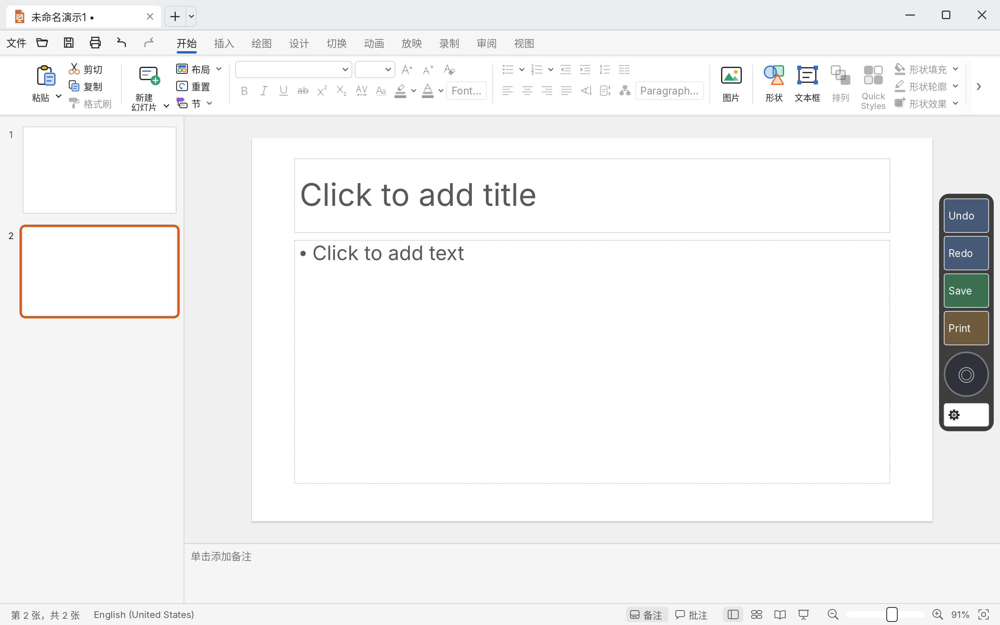
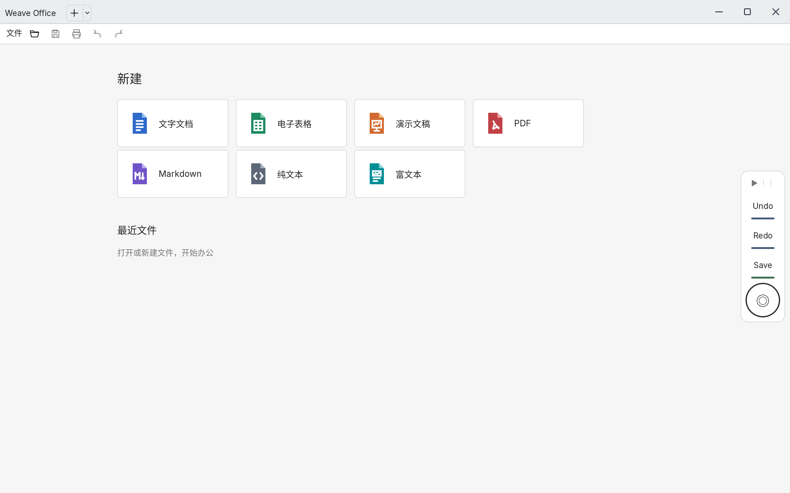
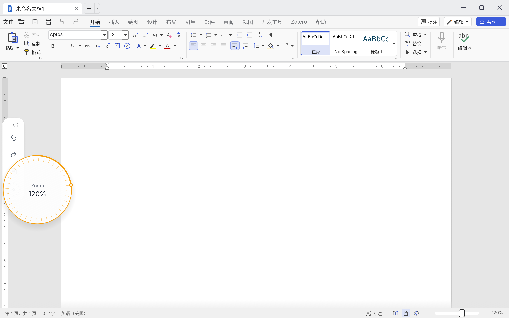
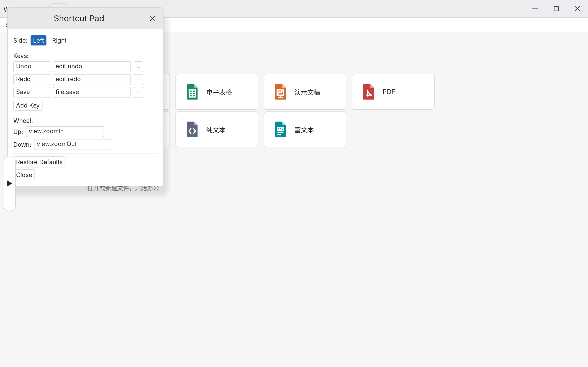

<p align="center">
  
</p>

<h1 align="center">Weave Office for Android</h1>

<p align="center">
  <b>The whole Weave Office workspace on an Android tablet.</b><br>
  Documents, spreadsheets, presentations, PDF, Markdown and rich text in one row of file tabs,<br>
  with the touch, pen, keyboard and file handling a tablet needs.
</p>

<p align="center">
  
  
  
  
  <a href="LICENSE"></a>
  
</p>

<p align="center">
  <a href="#install">Install</a> ·
  <a href="#screenshots">Screenshots</a> ·
  <a href="#what-the-port-adds">What the port adds</a> ·
  <a href="#gestures">Gestures</a> ·
  <a href="#build">Build</a> ·
  <a href="#keeping-up-with-upstream">Upstream</a>
</p>

> [!NOTE]
> This is an **unofficial community port** of [Weave Office](https://github.com/Jamailar/Weave-Office)
> to Android. It is not made or supported by the Weave Office developers. The desktop application,
> its documentation and its design are theirs; this repository adds the Android shell around the
> same engines.

## Install

Download the APK from [Releases](../../releases/latest) and sideload it:

```sh
adb install -r weave-office-<version>-arm64-v8a.apk
```

Android 8.0 (API 26) or newer, arm64-v8a. The APK is large (about 240 MB) because the four
engines and the bundled fonts are inside it; nothing is downloaded at first run.

## Screenshots

| | |
|---|---|
|  |  |
| The start screen: new documents and recent files | A presentation, with the Shortcut Pad on the edge |
|  |  |
| The wheel opens into a zoom dial, stepless and range-aware | The pad's settings: side, one-finger behaviour, keys, wheel |

## What the port adds

The engines (wordcraft, gridcraft, deckcraft, pdfcraft) and the host are the upstream ones. What
this repository adds is the Android shell: `apps/weave-office-android`.

| | |
|---|---|
| **Documents** | Android's Storage Access Framework for Open and Save, through a small file bridge the Activity and the app share; picked documents are copied in, saves are copied back to the document they stand for |
| **Open with / Share** | `ACTION_VIEW` and `ACTION_SEND` for docx, xlsx, pptx, pdf, md and txt |
| **Soft keyboard** | winit's Android backend drops GameActivity's text events, so the shell polls the keyboard's text state and replays it as egui text, Backspace and Enter; the keyboard is put away when the text field goes |
| **Keyboard shortcuts** | winit never reports modifiers on Android, so the shell tracks Ctrl, Shift and Alt from their own key events and stamps them onto every key event: Ctrl+C, Ctrl+V, Ctrl+Z, Ctrl+A, Shift+arrows all work on a hardware keyboard |
| **Shortcut Pad** | A light card on either edge: compact 36 pt square keys with line icons and tooltips, and a wheel that opens into a 150 pt zoom dial — stepless (a full turn doubles the zoom), with an arc that shows where the zoom sits in the editor's own range (10–500% Word, 10–400% Excel and PowerPoint, 8–6400% PDF). It folds with an animation, drags to either edge, snaps, and remembers where it was |
| **Touch gestures** | A gesture recogniser turns fingers into the mouse events a finger cannot make: tap selects, drag scrolls, long press then drag moves, long press and release adds to the selection, two fingers scroll |
| **Pen** | The stylus draws straight away (no long press) and its pressure sets the stroke width; the Activity reports the pointer's tool type because winit reports the pen as just another touch |
| **Clipboard** | The Activity publishes the system clipboard to the bridge and the app's copy writes back, so copy and paste work between Weave Office and other apps |
| **Printing** | A pad key can be pointed at `android.print`: the document is exported to PDF and handed to Android's print service |
| **Updates** | The app checks this repository's GitHub releases and installs the APK through Android's installer |
| **Phone layout** | A phone-class screen (smallest side under 600 pt) gets the interface at 75% |
| **Fonts** | The bundled open fonts plus the device's own: the editors' font menus list the system families (Noto Sans CJK, Noto Serif CJK, OEM faces) beside the bundled ones. Proprietary Office fonts are never shipped; a document that names Times New Roman or Calibri draws in the metric-compatible open substitute (Liberation Serif, Carlito) |

## Gestures

| Gesture | What it does |
|---|---|
| Tap | Click: select a shape, put the caret, press a button |
| Drag | Scroll; in a presentation, a flick changes slides |
| Long press, then drag | Drag: move a shape, sweep a marquee, select text |
| Long press, release in place | Ctrl+click: add to the selection |
| Two fingers | Scroll by their centroid |
| Pen | Drags straight away; pressure sets the ink width |

The pad's settings can make a one-finger drag drag straight away instead ("Mouse"), for anyone who
prefers a mouse everywhere.

## Build

```sh
export ANDROID_HOME=...            # SDK with platform 35 and build-tools
export ANDROID_NDK_HOME=...        # NDK r27 or newer
export CRAFT_FONTS_DIR=...         # the pinned craft-fonts checkout
export WEAVE_DOCUMENT_FONTS_DIR=... # the pinned document font input
apps/weave-office-android/build.sh
```

The APK lands in `target/android/weave-office-<version>-arm64-v8a.apk`. [docs/android/build.md](docs/android/build.md)
has the pinned inputs and the details; [docs/android/STATUS.md](docs/android/STATUS.md) is the
port's status log.

The release key is committed (`apps/weave-office-android/android/weave-release.jks`) on purpose:
this is a community prototype whose update channel is this repository's own releases, so the key
only has to keep one build's updates apart from another's — and a key every build shares is what
lets CI's APK update a locally built one. A fork that publishes its own releases should point
`WEAVE_KEYSTORE` at its own key.

## Keeping up with upstream

This repository is a fork of [Jamailar/Weave-Office](https://github.com/Jamailar/Weave-Office) with
the Android shell added on top, so upstream's work arrives with a merge rather than a rewrite:

```sh
git remote add upstream https://github.com/Jamailar/Weave-Office.git   # once
git fetch upstream
git merge upstream/main
```

The port's own changes are kept in a few places, so a merge rarely conflicts:

- `apps/weave-office-android/` — the Android shell (new files)
- `docs/android/` — its documentation (new files)
- `crates/system-fonts/` — Android's font folders
- `src/app.rs`, `Cargo.toml` — the host's Android hooks and the vendored dependency patches

When upstream changes an engine's API, the shell is what needs updating; the engines themselves are
vendored under `vendor/` and are not modified by the port.

## Layout

```
apps/weave-office-android/   the Android shell: Activity, bridge, IME, gestures, Shortcut Pad
crates/                      the host's shared crates (fonts, i18n, document fonts)
src/                         the host application
vendor/                      the four engines (wordcraft, gridcraft, deckcraft, pdfcraft)
docs/android/                the port's documentation and screenshots
```

## Credits and license

Weave Office is MIT licensed; see [LICENSE](LICENSE). The engines, the host and the design are the
upstream project's work — this repository only adds the Android shell. The bundled fonts are open
licensed (OFL and friends); no proprietary font is shipped.
